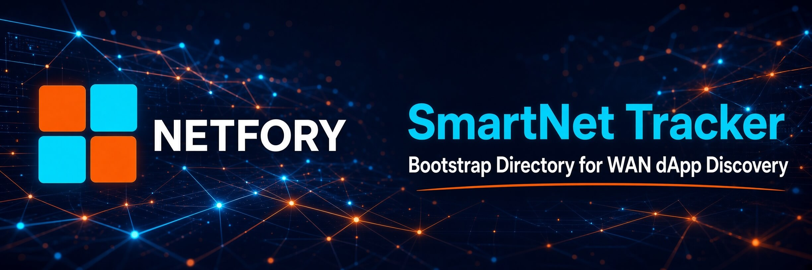

# SmartNet Tracker

A lightweight, standalone Rust (axum) **bootstrap directory** for WAN dApp
discovery. It lets SmartNet nodes find each other over the internet when LAN
mDNS is not enough.

The tracker is **stateless on disk**: it keeps only an in-memory registry of
*signed* app announcements with a TTL heartbeat. It **never stores blobs**
the actual dApp content still moves peer-to-peer over `iroh-blobs`.

## Trust model

Every announced app is verified with the exact SmartHoldem used by
the client. A spoofed announcement is rejected:

1. `id == base58check(0x3F ‖ ripemd160(secp256k1 compressed pubkey))`
2. The ECDSA signature over `sha256(id|name|description|merkle)` must verify
   against that public key.

## Build & run

```bash
cd tracker
cargo build --release
./target/release/ntfry-tracker
```

Defaults: binds `0.0.0.0:7374`, announcement TTL `120s`.

Override via env:

```bash
SMARTNET_TRACKER_PORT=7374 \
SMARTNET_TRACKER_TTL=120 \
SMARTNET_TRACKER_LOG_ANNOUNCE=1 \
  ./target/release/ntfry-tracker
```

- `SMARTNET_TRACKER_LOG_ANNOUNCE` log every accepted (`INFO`) / rejected
  (`WARN`) announce. **On by default**; disable with `0` (also `false`/`off`/`no`).
  Stats counters in `/stats` keep counting even when logging is off.

The client ships these public seed trackers by default (configurable in
**Settings -> P2P -> WAN TRACKERS**):

```
http://159.69.188.60:7374
```

## API

| Method | Path        | Purpose                                                                                             |
|--------|-------------|-----------------------------------------------------------------------------------------------------|
| GET    | `/`         | HTML status dashboard (auto-refreshes `/stats`) open in a browser                                   |
| POST   | `/announce` | Heartbeat: register/refresh the apps a node serves                                                  |
| GET    | `/apps`     | All known apps (deduped) with seed counts + providers                                               |
| GET    | `/app/:id`  | Providers for a single app id                                                                       |
| GET    | `/seeds`    | Distinct live nodes (endpoints) seen recently                                                       |
| GET    | `/stats`    | Aggregate stats: live apps/providers/endpoints, lifetime accept/reject totals, top-10 apps by seeds |
| GET    | `/health`   | Liveness + registry stats                                                                           |

### POST /announce

```json
{
  "node": "S...",                 // announcing node's SmartHoldem address (info)
  "endpointId": "<iroh node id>", // how peers reach this provider
  "apps": [{
    "id": "S...",                 // == address(publicKey)
    "name": "App",
    "description": "...",
    "tags": ["demo"],
    "merkle": "<blake3 root>",
    "hash": "<iroh-blobs tar hash>",
    "signature": "<ecdsa compact hex>",
    "publicKey": "<secp256k1 compressed hex>"
  }]
}
```

Response: `{ "ok": true, "accepted": N, "rejected": M, "ttlSecs": 120 }`.

## Tests

```bash
cargo test                          # crypto verify unit tests
cargo run --example gen_announce          # print a VALID announce  -> accepted
cargo run --example gen_announce tamper   # mutated after signing    -> rejected
cargo run --example gen_announce badid    # id != pubkey address     -> rejected
```
